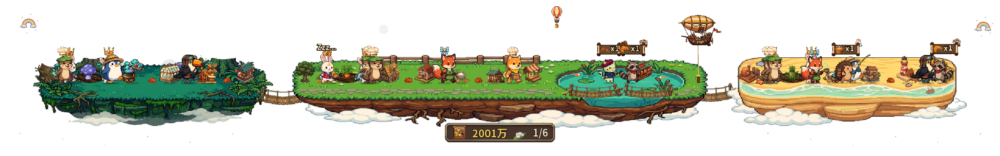

# 云岛集市 · Cloud Isle Market

> 趴在桌面底边的三座小浮岛，像养一盆会营业的盆栽（Godot 4.3，Windows）。



## 是什么

- **不用管它**：动物伙伴自己种、自己收、自己做、自己卖；窗口透明置顶、点穿不挡事。
- **每天看一眼**：离开时来过哪些客人，回来一张小图告诉你；来得多的客人会留下纪念物。
- **慢慢长**：2 号岛约一个半小时，3 号岛第 5 天左右，建筑全开约 25 天。
- **自己摆**：16 件纪念物和 8 件小装饰直接拖着摆，伙伴歇工时会走过去用。
- **看真实的天**：昼夜两小时一换，节气跟着日历走。
- 中文、英文、日文。

数值与节奏只有一处来源：`src/data/Pacing.gd`；客人与装饰在 `src/data/Guests.gd`。设计见 `PRD.md` §10B，开发铁律见 `GEMINI.md`。

## 运行

需要 Godot 4.3（Windows 64 位）：

```powershell
Godot_v4.3-stable_win64.exe --path .
```

自检在隐藏桌面静音运行，不弹窗：`tools/hidden_run.py`。打包：`package_win64.ps1`（版本号取自 `project.godot` 的 `config/version`）。

素材来源见 `ASSETS_LICENSE.md`，商店文案草稿见 `docs/store/steam_store.md`。
