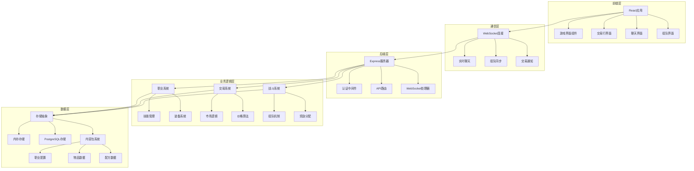
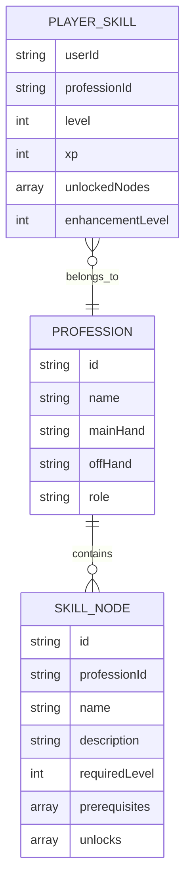
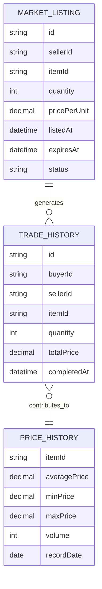
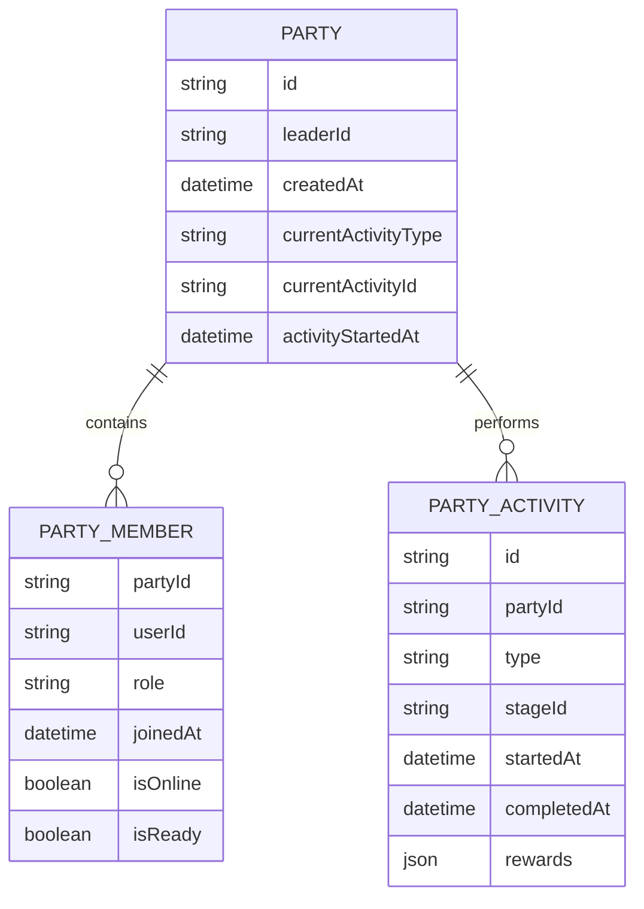

# 设计文档

## 概述

本设计文档描述WorkLife多职业放置RPG系统的实际实现架构。系统基于Express后端、React前端和WebSocket实时通信，实现了6个专业职业的完整游戏体验，包括采集、制作、战斗、交易和社交功能。

核心设计理念是创建一个简洁直观的放置RPG游戏，支持桌面和移动端，提供深度的职业专精、资源生产链和多人交互功能。系统已完成核心功能开发，处于生产就绪状态。

## 架构

### 系统架构概览



### 数据流架构

系统采用事件驱动的架构模式，通过WebSocket连接处理实时更新（聊天、组队、交易通知），通过REST API处理状态变更操作（制作、战斗、交易）。所有数据变更通过PostgreSQL数据库持久化，确保数据一致性和可靠性。

## 组件和接口

## 组件和接口

### 前端UI设计原则（银河奶牛放置风格）

基于银河奶牛放置等成功放置游戏的UI设计理念，前端界面应遵循以下设计原则：

#### 核心设计理念
- **简洁直观**：界面元素清晰明了，用户能够一眼看懂功能
- **移动优先**：优先考虑移动设备的交互体验，适配各种屏幕尺寸
- **即时反馈**：每次点击都有明确的视觉和数值反馈
- **渐进式复杂度**：随着玩家进度逐步展示更多功能，避免初期界面过于复杂

#### 布局设计
```
┌─────────────────────────────────┐
│        顶部状态栏                │
│   金币 | 经验 | 职业等级          │
├─────────────────────────────────┤
│                                 │
│        主要操作区域              │
│     (大按钮，易于点击)           │
│                                 │
├─────────────────────────────────┤
│    底部导航栏                   │
│ 背包|技能|交易|聊天|组队         │
└─────────────────────────────────┘
```

#### 按钮设计规范
- **主要操作按钮**：大尺寸（最小44px高度），圆角设计，明显的阴影效果
- **次要操作按钮**：中等尺寸，扁平设计或轻微阴影
- **危险操作按钮**：红色系配色，明显区分
- **拇指区域优化**：重要按钮放置在屏幕下方易于触及的区域

#### 颜色系统
- **主色调**：深蓝色太空背景，营造科幻氛围
- **强调色**：金黄色（金币、重要按钮）、绿色（成功状态）、红色（警告/危险）
- **职业色彩**：每个职业有独特的主题色彩
  - 伐木工：棕色/绿色系
  - 铁匠：灰色/橙色系
  - 农民：绿色/黄色系
  - 厨师：红色/橙色系
  - 裁缝：紫色/粉色系
  - 炼金术师：蓝色/紫色系

#### 动画和反馈
- **点击反馈**：按钮按下效果，数值增长动画
- **进度动画**：技能经验条、制作进度条的平滑动画
- **奖励动画**：获得物品时的飞入动画和粒子效果
- **状态变化**：职业切换、模式切换的过渡动画

### 扩展的数据模型

#### 增强的PlayerState结构
```typescript
interface EnhancedPlayerState extends PlayerState {
  // 扩展现有技能系统
  skills: Record<string, {
    level: number;
    xp: number;
    unlockedRecipes: string[];
    enhancementLevel: number;
  }>;
  
  // 新增组队状态
  partyState?: {
    partyId: string;
    role: string;
    isLeader: boolean;
    joinedAt: string;
  };
  
  // 增强的装备系统
  equipment: {
    main_hand?: string;
    off_hand?: string;
    enhancementLevels: Record<string, number>;
  };
  
  // 交易行相关状态
  tradingState: {
    activeListings: string[];
    purchaseHistory: Array<{
      itemId: string;
      price: number;
      timestamp: string;
    }>;
  };
  
  // 离线进度队列
  activityQueue: Array<{
    actionId: string;
    priority: number;
    estimatedDuration: number;
  }>;
}
```

#### 新增数据结构

```typescript
// 交易行列表
interface MarketListing {
  id: string;
  sellerId: string;
  itemId: string;
  quantity: number;
  pricePerUnit: number;
  listedAt: string;
  expiresAt: string;
  status: 'active' | 'sold' | 'expired' | 'cancelled';
}

// 组队系统
interface Party {
  id: string;
  leaderId: string;
  members: Array<{
    userId: string;
    role: string;
    joinedAt: string;
    isOnline: boolean;
  }>;
  currentActivity?: {
    type: 'combat' | 'group_craft';
    stageId?: string;
    startedAt: string;
  };
  createdAt: string;
}

// 增强的内容包结构
interface EnhancedContentPack extends ContentPack {
  professionTrees: Array<{
    professionId: string;
    skillNodes: Array<{
      id: string;
      name: string;
      description: string;
      requirements: {
        level: number;
        prerequisites: string[];
      };
      unlocks: {
        recipes?: string[];
        actions?: string[];
        enhancements?: string[];
      };
    }>;
  }>;
  
  enhancementRules: Array<{
    itemType: string;
    requiredProfession: string;
    materials: Array<{
      itemId: string;
      quantity: number;
    }>;
    successRate: number;
    maxLevel: number;
  }>;
}
```

### 前端组件架构

#### 核心UI组件

```typescript
// 主游戏界面组件
interface GameMainInterface {
  // 顶部状态栏
  StatusBar: {
    goldDisplay: number;
    experienceBar: { current: number; max: number; };
    professionLevel: number;
    professionIcon: string;
  };
  
  // 主操作区域
  ActionArea: {
    currentAction: string;
    progressBar: { progress: number; duration: number; };
    actionButton: { text: string; enabled: boolean; };
    quickActions: Array<{ id: string; name: string; icon: string; }>;
  };
  
  // 底部导航
  BottomNavigation: {
    tabs: Array<{
      id: 'inventory' | 'skills' | 'trading' | 'chat' | 'party';
      icon: string;
      badge?: number;
      active: boolean;
    }>;
  };
}

// 交易行界面组件
interface TradingInterface {
  searchBar: {
    query: string;
    filters: {
      itemType: string[];
      tier: number[];
      profession: string[];
      priceRange: { min: number; max: number; };
    };
  };
  
  itemGrid: Array<{
    listing: MarketListing;
    itemInfo: ItemInfo;
    sellerInfo: { name: string; profession: string; };
  }>;
  
  myListings: Array<MarketListing>;
  
  listItemModal: {
    selectedItem: string;
    quantity: number;
    pricePerUnit: number;
    estimatedFee: number;
  };
}

// 聊天界面组件
interface ChatInterface {
  channelTabs: Array<{
    id: 'world' | 'profession' | 'party' | 'private';
    name: string;
    unreadCount: number;
    active: boolean;
  }>;
  
  messageList: Array<{
    id: string;
    sender: string;
    content: string;
    timestamp: string;
    channel: string;
    senderProfession?: string;
  }>;
  
  inputArea: {
    message: string;
    targetChannel: string;
    privateRecipient?: string;
  };
}

// 组队界面组件
interface PartyInterface {
  partyStatus: {
    isInParty: boolean;
    partyId?: string;
    isLeader?: boolean;
  };
  
  memberList: Array<{
    userId: string;
    name: string;
    profession: string;
    level: number;
    isOnline: boolean;
    isReady: boolean;
  }>;
  
  inviteSystem: {
    pendingInvites: Array<{
      fromUserId: string;
      fromUserName: string;
      partyId: string;
      timestamp: string;
    }>;
    searchResults: Array<{
      userId: string;
      name: string;
      profession: string;
      level: number;
    }>;
  };
  
  activityPanel: {
    currentActivity?: {
      type: 'combat' | 'group_craft';
      name: string;
      progress: number;
      estimatedCompletion: string;
    };
    availableActivities: Array<{
      id: string;
      name: string;
      requiredMembers: number;
      recommendedRoles: string[];
    }>;
  };
}
```

#### 响应式设计规范

```css
/* 移动优先的响应式断点 */
.mobile-first {
  /* 手机 (320px - 768px) */
  font-size: 14px;
  button-height: 44px;
  touch-target: 44px;
  
  /* 平板 (768px - 1024px) */
  @media (min-width: 768px) {
    font-size: 16px;
    button-height: 40px;
  }
  
  /* 桌面 (1024px+) */
  @media (min-width: 1024px) {
    font-size: 18px;
    button-height: 36px;
  }
}

/* 银河奶牛放置风格的视觉效果 */
.galaxy-cow-style {
  background: linear-gradient(135deg, #1a1a2e, #16213e, #0f3460);
  border-radius: 8px;
  box-shadow: 0 4px 12px rgba(0, 0, 0, 0.3);
  
  /* 按钮样式 */
  .primary-button {
    background: linear-gradient(45deg, #ffd700, #ffed4e);
    color: #1a1a2e;
    border: none;
    border-radius: 6px;
    font-weight: bold;
    text-shadow: 1px 1px 2px rgba(0, 0, 0, 0.2);
    box-shadow: 0 2px 8px rgba(255, 215, 0, 0.3);
    transition: all 0.2s ease;
  }
  
  .primary-button:active {
    transform: translateY(1px);
    box-shadow: 0 1px 4px rgba(255, 215, 0, 0.3);
  }
  
  /* 进度条样式 */
  .progress-bar {
    background: rgba(255, 255, 255, 0.1);
    border-radius: 10px;
    overflow: hidden;
  }
  
  .progress-fill {
    background: linear-gradient(90deg, #00ff88, #00cc6a);
    height: 100%;
    transition: width 0.3s ease;
    box-shadow: 0 0 10px rgba(0, 255, 136, 0.5);
  }
}
```

### API接口扩展

#### 新增REST端点

```typescript
// 交易行API
app.get('/trading/listings', async (req, reply) => {
  // 获取市场列表，支持筛选和搜索
});

app.post('/trading/list', async (req, reply) => {
  // 上架物品出售
});

app.post('/trading/purchase', async (req, reply) => {
  // 购买物品
});

// 组队API
app.post('/party/create', async (req, reply) => {
  // 创建队伍
});

app.post('/party/invite', async (req, reply) => {
  // 邀请玩家加入队伍
});

app.post('/party/join', async (req, reply) => {
  // 接受队伍邀请
});

// 增强系统API
app.post('/enhancement/enhance', async (req, reply) => {
  // 装备强化
});

app.get('/enhancement/services', async (req, reply) => {
  // 获取可用的强化服务
});

// 技能系统API
app.get('/skills/tree/:professionId', async (req, reply) => {
  // 获取职业技能树
});

app.post('/skills/unlock', async (req, reply) => {
  // 解锁技能节点
});
```

#### WebSocket消息扩展

```typescript
// 聊天系统消息
interface ChatMessage {
  type: 'chat:message' | 'chat:join' | 'chat:leave';
  channel: 'world' | 'profession' | 'party' | 'private';
  sender?: string;
  recipient?: string; // 私聊时使用
  content: string;
  timestamp: string;
}

// 组队系统消息
interface PartyMessage {
  type: 'party:invite' | 'party:join' | 'party:leave' | 'party:activity';
  partyId: string;
  userId: string;
  data?: any;
}

// 交易系统消息
interface TradingMessage {
  type: 'trading:sold' | 'trading:purchased' | 'trading:expired';
  listingId: string;
  itemId: string;
  quantity: number;
  price: number;
}
```

## 数据模型

### 职业系统数据模型

每个职业都有独特的技能树结构，包含多个技能节点。技能节点解锁新的配方、行动或强化能力。系统使用现有的技能经验机制，但扩展为更细粒度的进度跟踪。



### 交易系统数据模型

交易行系统使用独立的数据表存储市场列表，支持复杂的搜索和筛选功能。系统包含价格历史跟踪和自动过期机制。



### 组队系统数据模型

组队系统支持最多6人的队伍，包含角色平衡建议和活动同步机制。系统跟踪成员状态和活动进度。



## 核心实现特性

基于实际完成的功能，以下是系统的核心实现特性：

### 特性1：完整的职业系统
系统实现了6个职业（伐木工、矿工、农夫、厨师、裁缝、炼金术师），每个职业支持采集、加工、制作等活动类型，并产生符合职业特性的结果。

### 特性2：资源生产链
制作和加工活动严格遵循配方定义，输入材料消耗和输出产品生成保持一致性，确保游戏经济平衡。

### 特性3：技能进度系统
玩家活动正确分配经验到相应技能类别，技能等级提升解锁新的配方和能力。

### 特性4：战斗系统
战斗系统考虑职业角色、装备属性、技能等级等因素，提供平衡的战斗体验。

### 特性5：交易行系统
交易操作（上架、购买）确保原子性，支持物品搜索、筛选和价格查询。

### 特性6：实时通信
通过WebSocket实现聊天、组队、交易通知等实时功能，提供流畅的多人交互体验。

### 特性7：移动端适配
完整的响应式设计，支持各种屏幕尺寸，优化触摸交互和性能。

### 特性8：数据持久化
所有游戏状态通过PostgreSQL数据库持久化，确保数据安全和一致性。
## 错误处理

### 错误处理策略

系统采用分层错误处理策略：

#### API层错误处理
- **输入验证错误**：验证所有输入，返回详细的错误信息
- **认证错误**：JWT验证失败时返回401状态码
- **权限错误**：权限不足时返回403状态码
- **资源不存在错误**：返回404状态码

#### 业务逻辑层错误处理
- **前置条件失败**：技能等级不足、材料不够等情况提供友好提示
- **资源耗尽**：背包空间不足、金币不够等情况提供明确说明
- **操作限制**：冷却时间等约束违反时提供等待时间

#### 数据层错误处理
- **数据库错误**：记录错误日志，返回友好的错误消息
- **数据一致性**：使用事务确保数据完整性

#### WebSocket错误处理
- **连接断开**：自动重连机制
- **消息格式错误**：忽略无效消息，记录日志

## 测试策略

### 测试方法

系统采用手动测试和自动化测试相结合的策略：

#### 手动测试
- **功能测试**：验证每个功能的正确性
- **UI测试**：测试用户界面的交互和显示
- **兼容性测试**：测试不同浏览器和设备的兼容性
- **性能测试**：测试系统在不同负载下的表现

#### 自动化测试（计划中）
- **单元测试**：测试独立组件和函数
- **集成测试**：测试组件间的交互
- **端到端测试**：测试完整的用户流程
- **性能测试**：自动化性能监控

### 测试环境
- **本地测试**：localhost开发环境
- **公网测试**：Ngrok公网环境
- **移动端测试**：真实设备和模拟器